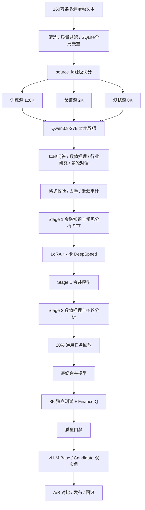

<div align="center">

# 金融大模型领域微调与数值推理增强

**SFT · LoRA · DeepSpeed · vLLM · LLMOps**

面向金融问答、行业研究与财务分析的完整领域微调工程：

**金融数据治理 → 本地监督数据生成 → 两阶段 SFT → 4 卡分布式训练 → 质量评测 → 推理加速 → 模型发布与回滚**

</div>

**English:** [Full English README](README_EN.md)

## Research / engineering summary for academic collaborators

**Project:** Financial domain adaptation and numerical reasoning with Qwen3.5-9B.

- Built a source-traceable data pipeline covering approximately 1.6 million financial text records, 128,000 generated supervised examples, and an 8,000-sample source-isolated held-out evaluation set.
- Implemented two-stage LoRA SFT with four-GPU DeepSpeed ZeRO-2, model merging, vLLM serving, and independent evaluation.
- Improved financial task accuracy from 51.8% to 73.6%, numerical/factual accuracy from 62.4% to 81.1%, and reduced unsupported numerical generation from 14.7% to 5.2%.
- Training compute used rented NVIDIA RTX 4090 24GB GPU resources. The repository documents the distributed training configuration and evaluation pipeline.

**Research emphasis:** Data leakage prevention, source-level splitting, assistant-only supervision, multi-stage adaptation, independent evaluation, and reproducible model release.


---

## 项目解决什么问题

通用大模型能够生成流畅的金融回答，但在企业场景中仍有四类直接影响上线的问题：

1. **专业知识覆盖不足**：面对金融概念、行业研究和财务分析时，回答容易停留在通用表述；
2. **数值与事实错误**：复杂计算、指标比较和时间口径容易出错；
3. **多轮分析断层**：连续追问时容易丢失前序假设、数字和分析范围；
4. **数字幻觉风险**：模型可能生成看似合理、但原文和计算过程均无法支持的数字。

本项目以 **Qwen3.5-9B** 为基座，通过金融领域数据生产、两阶段监督微调和专项质量门禁增强专业能力，并将训练结果接入可恢复、可评测、可灰度、可回滚的 LLMOps 流程。

---

## 核心结果

| 指标 | 基础模型 | 两阶段金融 SFT | 变化 | 企业价值 |
|---|---:|---:|---:|---|
| 金融综合任务正确率 | 51.8% | **73.6%** | **+21.8pp** | 减少专业问答、行业分析和财务任务的人工复核 |
| 数值与事实回答准确率 | 62.4% | **81.1%** | **+18.7pp** | 降低财务计算、指标比较和事实引用错误 |
| 无依据数字生成率 | 14.7% | **5.2%** | **下降约 65%** | 降低错误数字进入研报、客户问答和经营分析的风险 |

评测基于 **8,000 条 source-level 隔离测试样本**。项目评测快照见 [`reports/benchmark_snapshot.md`](reports/benchmark_snapshot.md)，评测代码位于 `scripts/evaluate_models.py` 与 `scripts/judge_quality.py`。

---

## 项目规模与关键设计

| 维度 | 配置 |
|---|---:|
| 原始金融文本 | **1,600,000 条** |
| 金融监督数据 | **128,000 条** |
| 验证集 | **2,000 条** |
| 独立测试集 | **8,000 条** |
| 数据教师模型 | **Qwen3.8-27B** |
| 微调基座 | **Qwen3.5-9B** |
| 微调方式 | **两阶段 SFT + LoRA** |
| 分布式训练 | **4-GPU DeepSpeed ZeRO-2** |
| 每次参数更新等价样本量 | **3 × 16 × 4 = 192** |
| 推理服务 | **vLLM + Tensor Parallel** |
| 外部金融知识评测 | **FinanceIQ** |

### 数据生产稳定性

在 5,000 条批量生成验证中成功生成 **4,999 条（99.98%）**。数据生成流程支持：

- 有界异步并发；
- 指数退避与错误日志；
- `source_id` 级断点恢复；
- JSON 格式与对话结构校验；
- 重复样本检测；
- 单轮与多轮样本混合构造。

这使金融训练数据从“人工逐条编写”转变为可重复执行、可追踪、可扩展的数据生产流程。

---

## 系统架构



---

## 关键技术实现

### 1. Source-level 数据隔离

训练、验证和测试集在生成监督问答之前，先根据原始文档内容生成稳定 `source_id` 并完成切分。这样可以避免：

- 同一篇金融原文以不同问法进入多个集合；
- 测试指标因内容泄漏而虚高；
- 模型只记住文章而非学习金融任务。

`audit_splits.py` 同时检查：

- `source_id` 跨集合重叠；
- 完整对话哈希重叠；
- 原始来源追踪字段完整性。

### 2. 单轮覆盖 + 多轮深度

数据体系同时包含：

- 金融知识问答；
- 财务与经营分析；
- 数值推理；
- 行业研究；
- 1–3 轮连续追问。

单轮样本扩大知识与任务覆盖，多轮样本强化上下文保持、连续分析和追问衔接。Stage 2 聚焦数值推理和多轮任务，同时回放 **20%** 其他金融任务，降低持续训练后的能力退化。

### 3. Assistant-only SFT

训练使用模型原生 Chat Template，并只对 assistant 回复区域计算损失：

- system / user token 标签设为 `-100`；
- 多轮对话中每一个 assistant turn 均参与监督；
- padding token 不参与损失；
- 训练、离线评测和在线服务使用同一对话格式。

这避免了通用 Collator 覆盖标签、prompt token 被错误训练以及 train–serve format mismatch。

### 4. Qwen3.5 混合注意力 LoRA

Qwen3.5 同时包含全注意力层和 Gated DeltaNet 线性注意力层。训练默认使用 PEFT `all-linear`，覆盖语言模型中的线性投影与 MLP，而不是只沿用旧模型的 `q_proj/k_proj/v_proj/o_proj` 列表。

项目通过 `Qwen3_5ForCausalLM` 仅加载语言骨干，不加载视觉塔，专注文本金融任务。

---

## 两阶段 SFT

### Stage 1：金融知识与常见分析任务

- 基座：`Qwen/Qwen3.5-9B`
- LoRA：`r=32, alpha=64`
- 学习率：`5e-6`
- 训练目标：金融知识、问答、行业研究、财务分析

### Stage 2：数值推理与多轮分析

- 基座：Stage 1 合并模型
- LoRA：`r=24, alpha=48`
- 学习率：`2e-6`
- 训练目标：数值计算、事实核验、连续追问
- 防遗忘：固定回放 **20%** 其他金融任务

### 为什么每次参数更新等价 192 条样本

训练配置为：

```text
每卡微批次 3 × 梯度累积 16 × 4 张 GPU = 全局有效批次 192
```

单张 GPU 每次只需要处理 3 条长序列，梯度在 16 个微批次后再同步更新。这样在不要求单卡容纳 192 条样本的前提下，仍能获得更稳定的大批次梯度。

---

## 分布式训练与 LLMOps

### 训练可靠性

- DeepSpeed ZeRO-2；
- CPU Optimizer Offload；
- Gradient Checkpointing；
- BF16 / FP16 自动选择；
- Checkpoint/Resume；
- Best Model Selection；
- TensorBoard 监控；
- LoRA 合并与独立部署。

### 早停与成本控制

- 每 **300 步**执行一次验证并保存检查点；
- 连续 **5 次**评估改善不足 `0.002` 时自动停止；
- 自动恢复验证集表现最佳的模型，而不是保留最后一次训练权重。

这可减少训练中断重跑、无效训练和过拟合覆盖最佳权重带来的 GPU 浪费。

### 模型版本与发布

```text
Stage 1 Adapter
    ↓ merge
Stage 1 Standalone Model
    ↓ Stage 2 SFT
Final Adapter
    ↓ merge
Candidate Standalone Model
    ↓ Offline Quality Gate
Base / Candidate 双实例 A/B
    ↓
Promote or Rollback
```

更多说明见 [`docs/LLMOPS.md`](docs/LLMOPS.md)。

---

## 推理加速与在线对比

基础模型和金融模型分别使用两张 GPU，通过 vLLM Tensor Parallel 提供 OpenAI-compatible API：

```text
GPU 0,1 → Qwen3.5-9B Base          → :8000
GPU 2,3 → Financial Qwen3.5-9B     → :8001
```

部署能力包括：

- 服务启动前 GPU 与端口检查；
- PID 与日志管理；
- `/v1/models` 健康检查；
- 异步并发 A/B 请求；
- Base / Candidate 同题对比；
- 模型版本追踪与快速回滚。

---

## 仓库结构

```text
.
├── .github/workflows/ci.yml
├── configs/
│   ├── ds_zero2.json
│   └── project_scale.yaml
├── deploy/
│   ├── start_teacher.sh
│   ├── stop_teacher.sh
│   ├── start_pair.sh
│   └── stop_pair.sh
├── docs/
│   ├── ARCHITECTURE.md
│   ├── DATA_PIPELINE.md
│   ├── DATA_SCHEMA.md
│   ├── EVALUATION.md
│   └── LLMOPS.md
├── examples/
├── reports/
│   ├── benchmark_snapshot.json
│   └── benchmark_snapshot.md
├── scripts/
│   ├── build_corpus.py
│   ├── sample_sources.py
│   ├── generate_sft.py
│   ├── validate_sft.py
│   ├── audit_splits.py
│   ├── partition_training_stages.py
│   ├── train_sft.py
│   ├── merge_lora.py
│   ├── make_benchmark.py
│   ├── evaluate_models.py
│   ├── judge_quality.py
│   ├── evaluate_financeiq.py
│   ├── build_report.py
│   ├── healthcheck.py
│   └── ab_compare.py
├── src/finllm_prod/
├── tests/
├── .env.example
├── Makefile
├── pyproject.toml
├── requirements.txt
└── run_pipeline.sh
```

---

## 快速开始

### 1. 安装

```bash
git clone https://github.com/Benjamindaoson/LLM-Fine-tuning.git
cd LLM-Fine-tuning

python -m venv .venv
source .venv/bin/activate
pip install -e '.[dev,serve]'
```

### 2. 配置路径

```bash
cp .env.example .env
set -a
source .env
set +a
```

### 3. 环境预检

```bash
./run_pipeline.sh preflight
```

### 4. 完整流水线

使用已经存在的本地 OpenAI-compatible 教师服务：

```bash
./run_pipeline.sh all
```

由项目自动启动和停止 Qwen3.8-27B 教师：

```bash
./run_pipeline.sh all-local
```

也可以分阶段执行：

```bash
./run_pipeline.sh corpus
./run_pipeline.sh sample
./run_pipeline.sh generate
./run_pipeline.sh validate
./run_pipeline.sh stage1
./run_pipeline.sh stage2
./run_pipeline.sh evaluate
```

---

## 数据治理

```bash
python scripts/build_corpus.py \
  --inputs /data/financial_news /data/announcements /data/reports \
  --output_dir /data/finllm/corpus \
  --min_unique 1600000
```

支持：

- JSONL / NDJSON；
- JSON；
- CSV；
- Parquet；
- 目录递归读取。

百万级精确去重使用 SQLite 磁盘索引，无需一次性把所有文本加载到内存。

---

## 本地监督数据生成

启动教师模型：

```bash
bash deploy/start_teacher.sh
python scripts/healthcheck.py \
  --url http://127.0.0.1:9000/v1 \
  --wait_seconds 900
```

生成训练数据：

```bash
python scripts/generate_sft.py \
  --input /data/finllm/selected_train_128k.jsonl \
  --output /data/finllm/sft_train_raw.jsonl \
  --error_log /data/finllm/train_generation_errors.jsonl \
  --concurrency 80 \
  --resume
```

原始金融文本通过本地 Qwen3.8-27B 生成训练样本，不需要发送到外部模型 API。

---

## 4 卡训练

### Stage 1

```bash
CUDA_VISIBLE_DEVICES=0,1,2,3 deepspeed --num_gpus=4 scripts/train_sft.py \
  --model_name_or_path Qwen/Qwen3.5-9B \
  --train_files /data/finllm/sft_stage1.jsonl \
  --eval_file /data/finllm/sft_val.jsonl \
  --output_dir /runs/finllm/stage1 \
  --per_device_train_batch_size 3 \
  --gradient_accumulation_steps 16 \
  --lora_r 32 \
  --lora_alpha 64 \
  --learning_rate 5e-6 \
  --epochs 5
```

### 合并 Stage 1

```bash
python scripts/merge_lora.py \
  --base_model Qwen/Qwen3.5-9B \
  --adapter /runs/finllm/stage1/best_adapter \
  --output /runs/finllm/stage1_merged
```

### Stage 2

```bash
CUDA_VISIBLE_DEVICES=0,1,2,3 deepspeed --num_gpus=4 scripts/train_sft.py \
  --model_name_or_path /runs/finllm/stage1_merged \
  --train_files /data/finllm/sft_stage2.jsonl \
  --eval_file /data/finllm/sft_val.jsonl \
  --output_dir /runs/finllm/multistage \
  --per_device_train_batch_size 3 \
  --gradient_accumulation_steps 16 \
  --lora_r 24 \
  --lora_alpha 48 \
  --learning_rate 2e-6 \
  --epochs 4
```

---

## 统一评测

### 生成与自动指标

```bash
python scripts/evaluate_models.py \
  --model base=Qwen/Qwen3.5-9B \
  --model sft=/runs/finllm/stage1_merged \
  --model multistage=/runs/finllm/multistage_merged \
  --benchmark /data/finllm/financial_test_8k.jsonl \
  --output_dir /runs/finllm/benchmark
```

### 金融正确性与数字幻觉评审

```bash
for name in base sft multistage; do
  python scripts/judge_quality.py \
    --input /runs/finllm/benchmark/${name}_generations.jsonl \
    --output /runs/finllm/quality/${name}_judged.jsonl \
    --model Qwen/Qwen3.8-27B
done
```

### 外部 FinanceIQ

```bash
python scripts/evaluate_financeiq.py \
  --model base=Qwen/Qwen3.5-9B \
  --model sft=/runs/finllm/stage1_merged \
  --model multistage=/runs/finllm/multistage_merged \
  --output_dir /runs/finllm/financeiq
```

---

## 双模型部署与 A/B

```bash
export TUNED_MODEL=/runs/finllm/multistage_merged
bash deploy/start_pair.sh
```

健康检查：

```bash
python scripts/healthcheck.py --url http://127.0.0.1:8000/v1
python scripts/healthcheck.py --url http://127.0.0.1:8001/v1
```

在线 A/B：

```bash
python scripts/ab_compare.py \
  --input /data/finllm/financial_test_8k.jsonl \
  --output /runs/finllm/online_ab.jsonl
```

---

## 测试

```bash
python tests/test_core.py
python -m compileall -q src scripts
bash -n run_pipeline.sh deploy/*.sh
```

CI 覆盖：

- assistant-only mask；
- 多轮 assistant supervision；
- `source_id` 与切分稳定性；
- 对话结构校验；
- 数据质量过滤；
- 数值事实指标；
- 中文字符 ROUGE；
- Python 与 Shell 语法检查。

---

## 数据与安全边界

本仓库不提交：

- 私有金融原文；
- 模型权重；
- LoRA Adapter；
- Checkpoint；
- API Key；
- 线上业务数据。

所有路径、模型服务地址和凭据均通过环境变量配置。

---

## License

Apache-2.0
